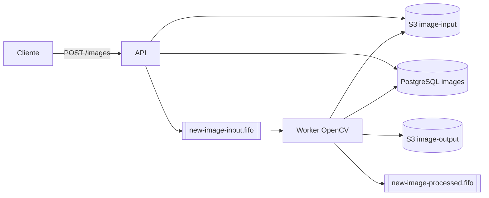

# Atividade ToT - teste

# Exercicio 1 - S3

1. Certifique-se de ter o Docker instalado e rodando.
2. No terminal, na raiz do projeto, execute: `docker compose up -d`
3. Os buckets S3 serão criados automaticamente pelo script na pasta `ready.d`.
4. Acesse a interface visual em `http://localhost:4500`.
5. Para desligar, execute `docker compose down`.
6. Verificar com curl `http://localhost:4566/_floci/init`
7. Resultado: `{"completed":{"boot":true,"start":true,"ready":true,"shutdown":false},"scripts":{"boot":[],"start":[],"ready":[{"return_code":0,"script":"/etc/floci/init/ready.d/criar-buckets.sh","state":"successful"}],"shutdown":[]}}`

# Exercicio 2 - SQS FIFO

1. Certifique-se de que o ambiente Docker via `docker compose up -d` está ativo.
2. As filas SQS FIFO são configuradas automaticamente na inicialização pelos scripts da pasta `ready.d`.
3. Para validar as filas criadas, utilize os comandos AWS CLI com o endpoint local ou consulte a interface visual em `http://localhost:4500`.

# Exercicio 03 - API Livros com SQS

1. Suba o ambiente local com o Floci usando: `docker compose up -d --build`
2. Inicie o servidor da API com: `uv run uvicorn app.main:app --reload`
3. Acesse a documentação interativa em: `http://localhost:8000/docs`
4. Para rodar os testes, execute: `uv run pytest`
5. Para verificar o estilo do código, execute: `uv run ruff check .`

# Exercicio 04 - Banco de Dados PostgreSQL

1. Suba os serviços adicionais de base de dados e interface com `docker compose up -d`.
2. Acesse o CloudBeaver em `http://localhost:8978` (login: `cbadmin` / `Tot12345`) para gerenciar a conexão `vddb`.
3. Execute os comandos SQL básicos de criação de tabelas, inserção e consulta diretamente no editor SQL.

# Exercicio 05 - SQLModel

1. Instale as dependências e execute o script de integração em Python:
   ```bash
   uv add sqlmodel "psycopg[binary]"
   uv run python 05-banco.py

# Exercicio 06 - Pipeline de imagens

A API recebe um PNG, guarda no S3, registra no banco e avisa a fila. O worker processa com OpenCV, guarda o resultado e avisa que terminou.



1. Copie as variáveis de ambiente: `cp .env.example .env`
2. Suba tudo (API, worker, Floci, floci-ui, PostgreSQL e CloudBeaver): `docker compose up --build`
3. Verifique a API: `curl http://localhost:8000/health`
4. Envie uma imagem: `curl -F "file=@imagem.png" http://localhost:8000/images`
5. Consulte o status com o id devolvido: `curl http://localhost:8000/images/<id>`
6. Liste filtrando por status: `curl "http://localhost:8000/images?status=processada"`
7. Documentação OpenAPI: `http://localhost:8000/docs`
8. Buckets `image-input` e `image-output` no floci-ui: `http://localhost:4500`
9. Tabela `images` no CloudBeaver: `http://localhost:8978` (banco `vddb`)
10. Para rodar os testes, execute: `uv run pytest`
